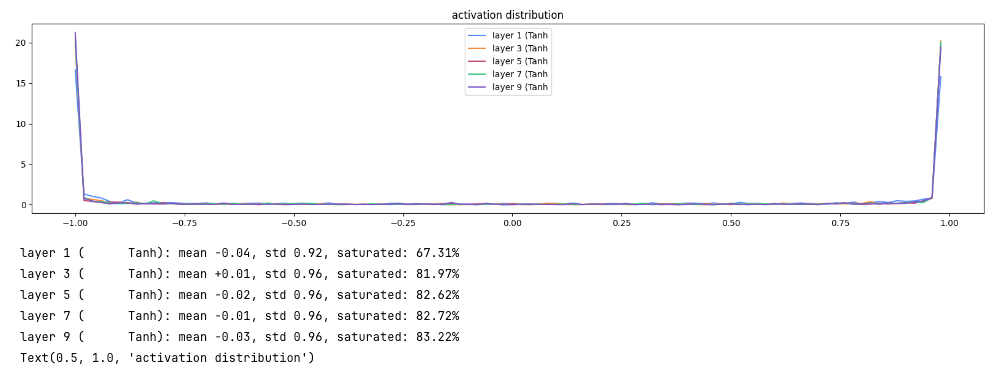
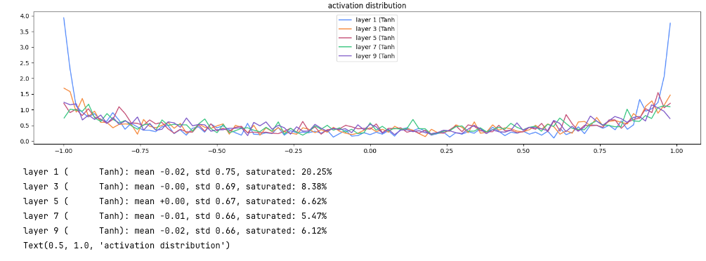
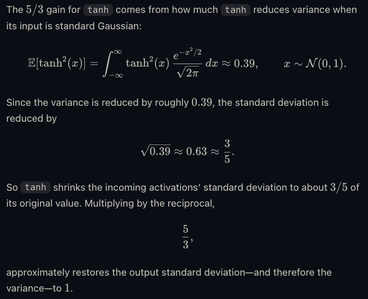

# Activation distributions

Histogram of the tanh outputs in each hidden layer, after one batch. The five lines are the five tanh layers. A good init keeps their std in the same band, around 0.65, with little mass stuck at ±1.

Conclusion:
A neuron multiplies each input by a weight and adds those products. Each product is a term. The total is the sum (the pre-activation), then tanh. 

If the terms are random and mean 0, more terms make the sum wander farther from 0. Typical size grows like √(term count): 
30 terms → about 5.5, 100 terms → about 10.

In 32×30 @ 30×100 → 32×100, 32 is the batch and 100 is 100 neurons (100 independent sums). One neuron adds 30 terms. Embeddings and weights both around size 1, so that sum is about √30 ≈ 5.5. Tanh saturates, 67.31%.

The next layer is 32×100 @ 100×100. One neuron now adds 100 terms, and those inputs are already tanh values near ±1. The sum is about √100 ≈ 10, so saturation jumps to 81.97%. Later layers stay around 82% because fan_in stays 100.

Scale each weight by 1 / √fan_in (30 on the first layer, 100 after that). That keeps one neuron’s sum around size 1, so tanh is not already stuck at ±1.

Tanh then pulls those numbers toward ±1. A spread of 1 comes out as a spread of about 0.63. That smaller vector is the next layer’s input, so the next sum is also too small, tanh squashes again, and the histogram gets a taller spike at 0. That is fan-in with no gain: std 0.62 → 0.48 → 0.41 → 0.35 → 0.32.

Gain is an extra multiplier on the weights so the sum going into tanh is a bit bigger than 1. For tanh that value is 5/3: 0.63 × 5/3 ≈ 1, so after the squash the next layer sees spread about 1 again. That is the 5/3 run: std settles near 0.66.

Gain too low (×1.5): the sum is still a bit small, so std drifts down (0.73 → 0.61). Gain too high (×3): the sum is too big, tanh saturates, and the layers stay hot (std near 0.84, about 40–48% at ±1).
Together: std of weights = (5/3) / √fan_in. 1/√fan_in cancels the growth from adding many terms. 5/3 cancels the shrinking from tanh.

## No fan-in, no gain

Weights stay at std 1. Each neuron adds many full-size terms, so the pre-activation is huge.

Std stays near 0.95, and saturation rises from 67% in the first tanh to 83% in the last. Most neurons are stuck at ±1, on the flat part of tanh, so they pass almost no gradient.

## Fan-in, no gain

Weights are divided by √fan_in. They are not multiplied by the tanh gain.

Saturation is about 0, and std falls from 0.62 to 0.32 from the first tanh to the last. Dividing by √fan_in stops the blow-up, and without the 5/3 gain, tanh keeps shrinking the spread every layer.

## Fan-in, gain ×3

Same fan-in scaling, with gain 3.

Std holds near 0.84 in every layer, and about 40–48% of the values are saturated. The gain is past 5/3, so the layers agree with each other, and they agree on being too hot.

## Fan-in, gain ×1.5

Same fan-in scaling, with gain 1.5.

Std falls from 0.73 to 0.61 and then levels off, and saturation falls from 14% to about 2%. This is close to stable, a little quieter than gain 5/3.

## Fan-in, gain ×5/3

This is `std = (5/3) / √fan_in`.

Std goes from 0.75 to 0.66, and the last three layers sit on 0.67, 0.66, and 0.66. Saturation falls from 20% to about 6%, so the spread holds from layer to layer.

