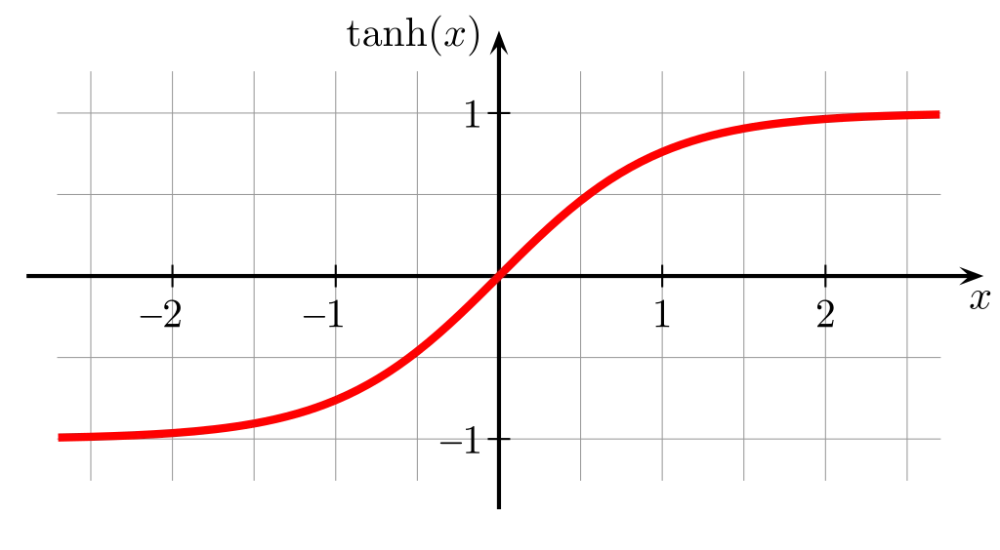

# Activation distributions

Histogram of the tanh outputs in each hidden layer, after one batch. The five lines are the five tanh layers. A good init keeps their std in the same band, around 0.65, with little mass stuck at ±1.

## No fan-in, no gain

Weights stay at std 1. Each neuron adds many full-size terms, so the pre-activation is huge.

Std stays near 0.95, and saturation rises from 67% in the first tanh to 83% in the last. Most neurons are stuck at ±1, on the flat part of tanh, so they pass almost no gradient.

## Fan-in, no gain

Weights are divided by √fan_in. They are not multiplied by the tanh gain.

Saturation is about 0, and std falls from 0.62 to 0.32 from the first tanh to the last. Dividing by √fan_in stops the blow-up, and without the 5/3 gain, tanh keeps shrinking the spread every layer.

## Fan-in, gain ×3

Same fan-in scaling, with gain 3.

Std holds near 0.84 in every layer, and about 40–48% of the values are saturated. The gain is past 5/3, so the layers agree with each other, and they agree on being too hot.

## Fan-in, gain ×1.5

Same fan-in scaling, with gain 1.5.

Std falls from 0.73 to 0.61 and then levels off, and saturation falls from 14% to about 2%. This is close to stable, a little quieter than gain 5/3.

## Fan-in, gain ×5/3

This is `std = (5/3) / √fan_in`.

Std goes from 0.75 to 0.66, and the last three layers sit on 0.67, 0.66, and 0.66. Saturation falls from 20% to about 6%, so the spread holds from layer to layer.
