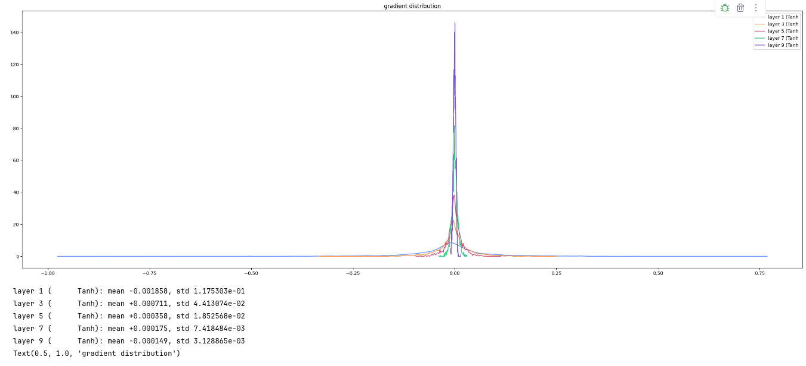
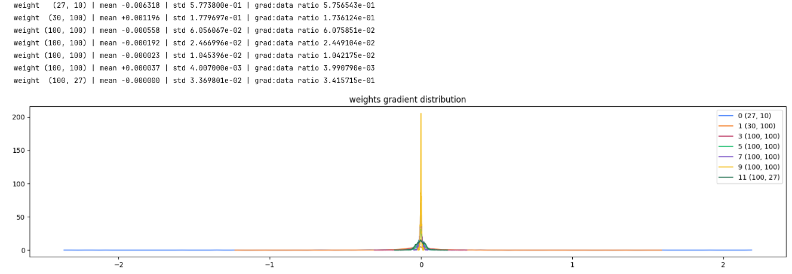
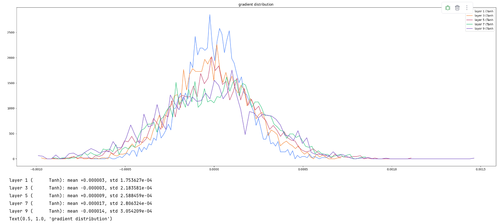
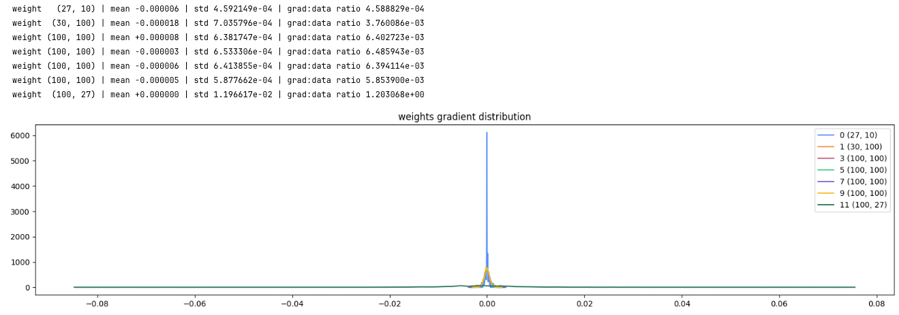
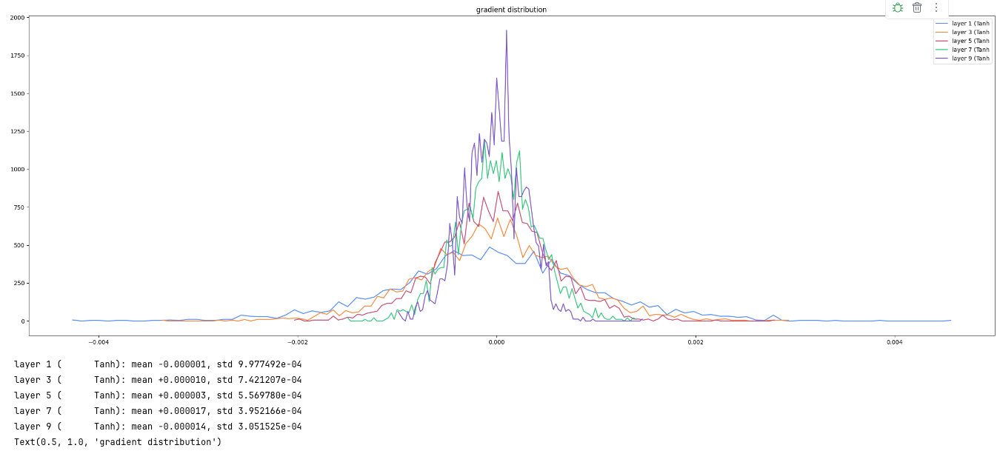
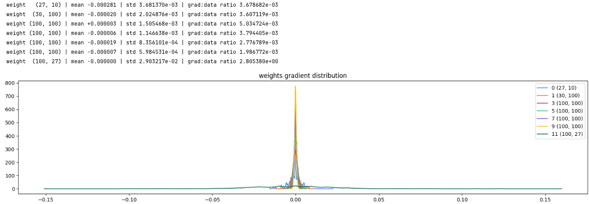
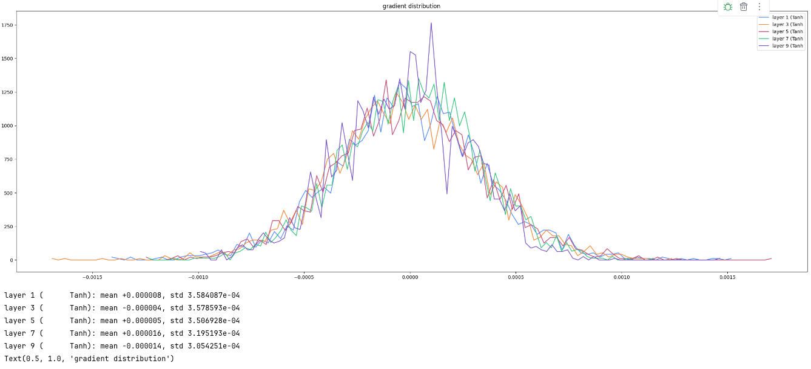
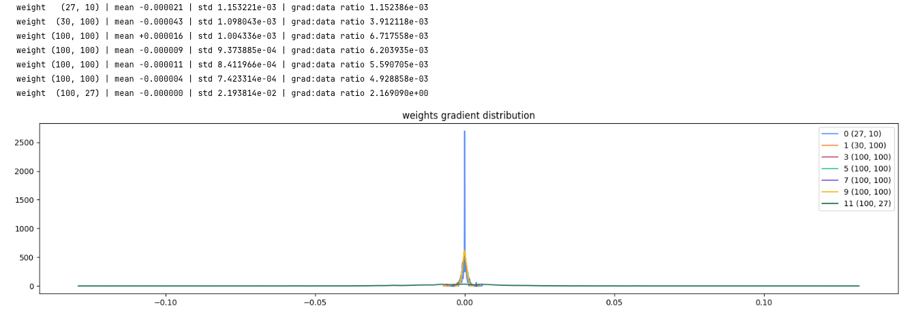
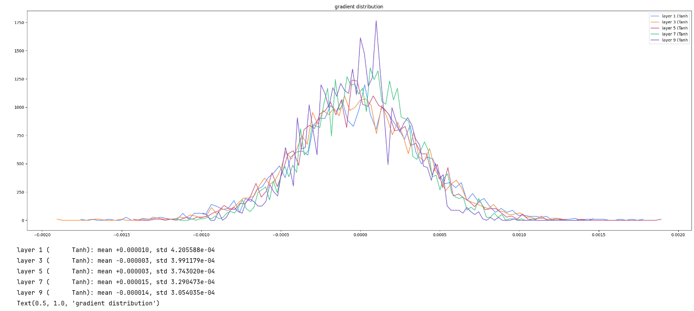
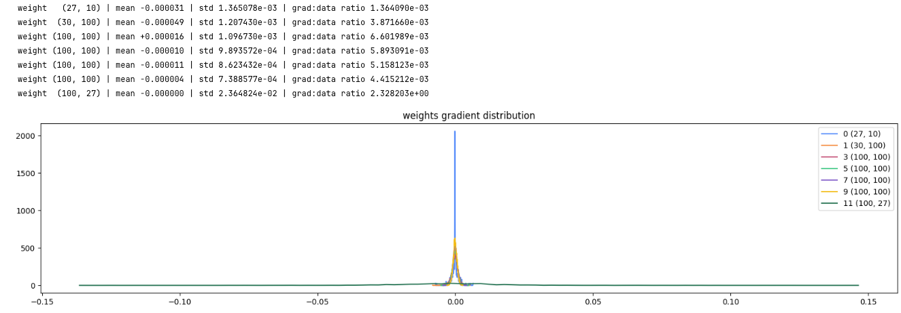

# Gradient distributions

Two plots per setting, from the same one-batch backward pass. The first is the gradient through each tanh layer. The second is the gradient of each weight matrix.

The last weight matrix is multiplied by 0.1, so its grad:data ratio is about 1 to 2 on every run. That one curve is much wider than the hidden layers, which is why those layers look like a thin peak at 0.

## No fan-in, no gain

**Tanh gradients**

**Weight gradients**

Tanh gradient std falls from 0.12 in the first hidden layer to 0.003 in the last. The hidden weight grad:data ratios drop the same way, from 0.17 to 0.004, so the early layers take a much bigger step than the deep ones.

## Fan-in, no gain

**Tanh gradients**

**Weight gradients**

Tanh gradient std stays between 0.00018 and 0.00031, and the hidden weight ratios sit near 0.006. The layers get a similar gradient. The problem with this setting is the activation std shrinking, in the other note.

## Fan-in, gain ×3

**Tanh gradients**

**Weight gradients**

Tanh gradient std drops from 0.0010 to 0.00031, and the hidden weight ratios drift from about 0.005 down to 0.002. Too much gain leaves the early layers with a larger gradient than the later ones.

## Fan-in, gain ×1.5

**Tanh gradients**

**Weight gradients**

Tanh gradient std only moves from 0.00036 to 0.00031. The hidden weight ratios stay around 0.004 to 0.007, so each hidden layer gets about the same size of update.

## Fan-in, gain ×5/3

**Tanh gradients**

**Weight gradients**

Tanh gradient std goes from 0.00042 to 0.00031, and the hidden weight ratios stay around 0.004 to 0.007. The update size matches gain 1.5, and the activation std stays a bit higher, near 0.66.
